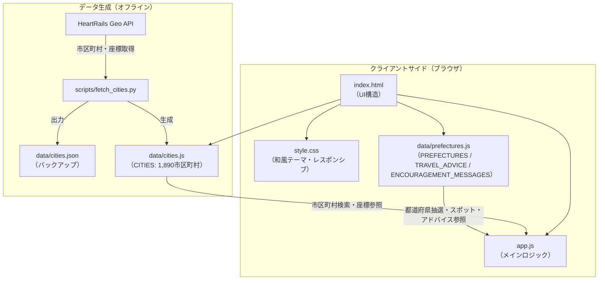
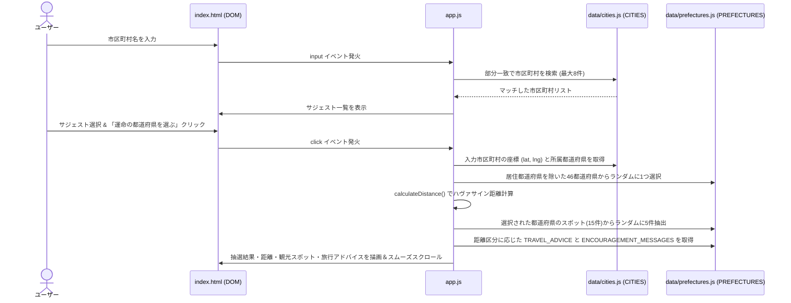
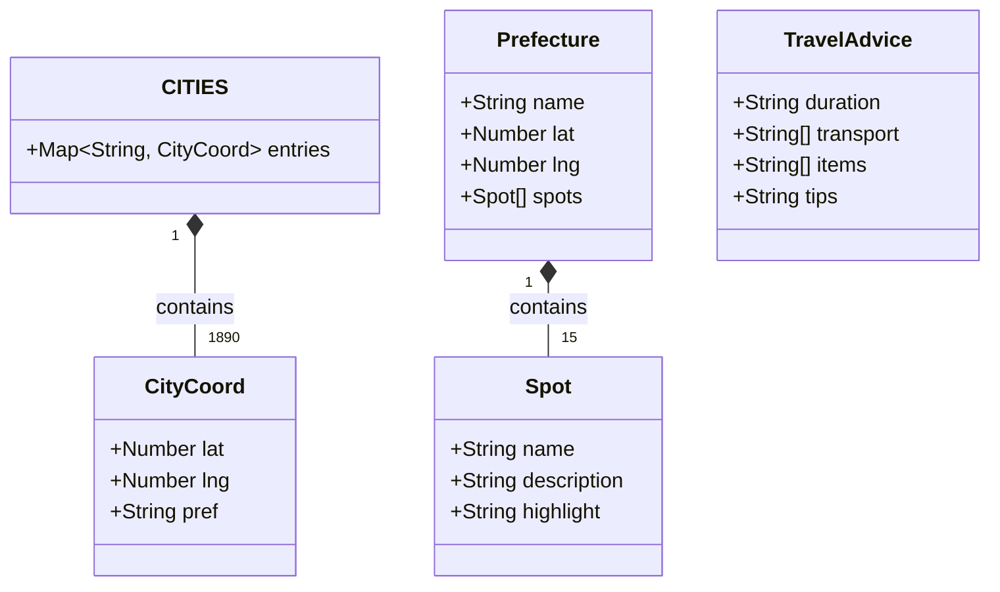

# 運命の旅先 - 日本都道府県発見アプリ

## 概要

**「運命の旅先」** は、お住まいの市区町村を入力するだけで、自分の住む都道府県を除いた日本の47都道府県からランダムに1つを「運命の旅先」として選び出し、地元の人しか知らないようなマニアックな観光スポットや郷土料理、現在地からの直線距離、および距離に応じた旅行準備アドバイスを提案するWebアプリケーションです。

全国1,890件の市区町村座標データ（HeartRails Geo API由来）と、47都道府県×15件（計705件）の観光・グルメデータを搭載し、和紙や伝統色（墨・朱・藍・金）を取り入れた和モダンなUIで日本の広さと魅力を再発見する体験を提供します。

---

## 主な機能

- 🔍 **市区町村インクリメンタルサジェスト**: 全国1,890件の市区町村データから入力文字に応じてリアルタイムに候補（最大8件）を表示
- 🎲 **運命の都道府県ガチャ**: 居住地の都道府県を除外した46都道府県からランダムに1つを抽選
- 📍 **マニアックな名所・郷土料理の提案**: 47都道府県×各15件（計705件）のデータから、抽選された都道府県のスポットをランダムに5件ピックアップして紹介
- 📏 **現在地からの距離計算**: ハヴァサイン公式（Haversine formula）を用い、居住地の市区町村から選ばれた都道府県の代表座標までの直線距離（km）を算出
- 🧳 **距離に応じた旅行アドバイス**: 算出された距離（〜100km / 100〜300km / 300〜500km / 500km〜）に応じて、おすすめの旅程・移動手段・持ち物リスト・ワンポイントアドバイスを自動提示
- 🎌 **和モダンなデザイン**: 和紙テクスチャや日本の伝統色（墨・朱・藍・金）、明朝体フォント（`Shippori Mincho`, `Noto Serif JP`）を用いた情緒あるUI

---

## アーキテクチャ・UML図

### システム構成図（コンポーネント関連図）



### 処理シーケンス図



### データモデル（クラス図）



---

## ディレクトリ構成

```text
Prefecture-choice/
├── index.html              # メインHTML（入力フォーム・結果表示セクション）
├── style.css               # スタイルシート（和紙テクスチャ・伝統色カラーパレット・アニメーション）
├── app.js                  # アプリケーションロジック（サジェスト・抽選・距離計算・DOM更新）
├── vercel.json             # Vercel 静的ホスティング設定
├── data/
│   ├── prefectures.js      # 47都道府県データ（各15スポット）、旅行アドバイス、励ましメッセージ
│   ├── cities.js           # 全国1,890市区町村の緯度・経度・都道府県データ
│   └── cities.json         # 市区町村データのJSONバックアップ
└── scripts/
    └── fetch_cities.py     # HeartRails Geo APIから全市区町村の座標データを取得・生成するPythonスクリプト
```

---

## 使い方

### 1. Webアプリの利用手順

1. **居住地の入力**: お住まいの市区町村（例：`渋谷区`、`大阪市北区`、`札幌市中央区`など）を入力欄に入力し、表示されるサジェスト候補から選択します。
2. **抽選の実行**: 「運命の都道府県を選ぶ」ボタンをクリックします。
3. **結果の確認**:
   - ランダムに選ばれた都道府県名と、現在地からの直線距離（km）
   - ランダムに選ばれた5つの隠れた名所・郷土料理
   - 距離に応じた旅行の準備アドバイス（旅程・移動手段・持ち物・ヒント）
   - 旅への一歩を後押しする励ましメッセージ
4. **再抽選**: 「別の運命を探す」ボタンをクリックすると、再度抽選を行えます。

### 2. ローカルでの実行方法

ビルドツール不要の静的Webアプリケーションのため、`index.html` をそのままブラウザで開くか、ローカルサーバーを起動して動作を確認できます。

```bash
# Pythonの簡易HTTPサーバーを使う場合
python3 -m http.server 8000
# ブラウザで http://localhost:8000 にアクセス
```

### 3. 市区町村データの再生成（任意）

`scripts/fetch_cities.py` を実行することで、[HeartRails Geo API](https://geoapi.heartrails.com/) から最新の全市区町村データを取得し、`data/cities.js` および `data/cities.json` を再生成できます。

```bash
python3 scripts/fetch_cities.py
```

---

## 技術スタック

- **フロントエンド**: HTML5 / CSS3 (Custom Properties, Flexbox, Responsive Design) / Vanilla JavaScript (ES6+)
- **フォント**: Google Fonts (`Shippori Mincho`, `Noto Serif JP`)
- **アルゴリズム**: ハヴァサイン公式（Haversine formula）による球面三角法距離計算
- **データ取得スクリプト**: Python 3 (`urllib`, `json`) + HeartRails Geo API
- **ホスティング**: Vercel (`@vercel/static`)

---

## デプロイ

[](https://vercel.com/new/clone?repository-url=https://github.com/sofardogood/Prefecture-choice)

---

## ライセンス

MIT License
